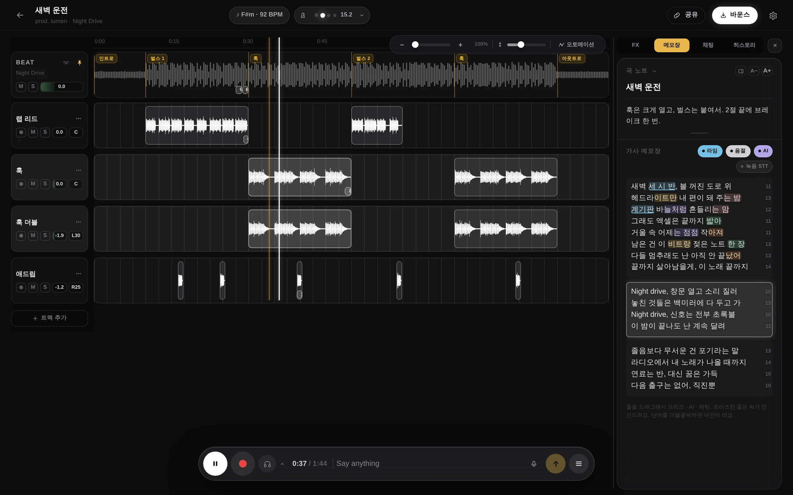
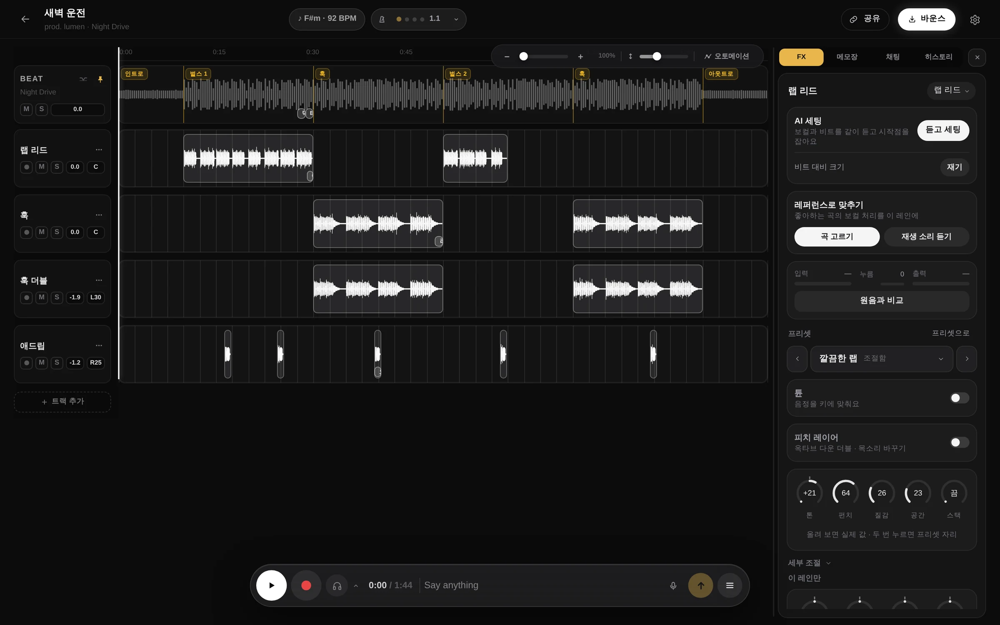
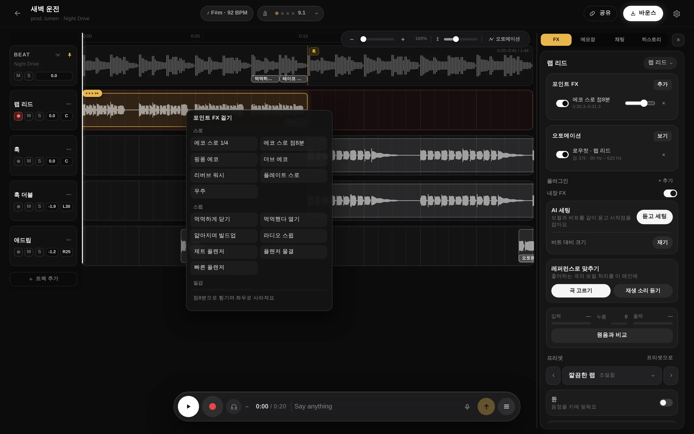
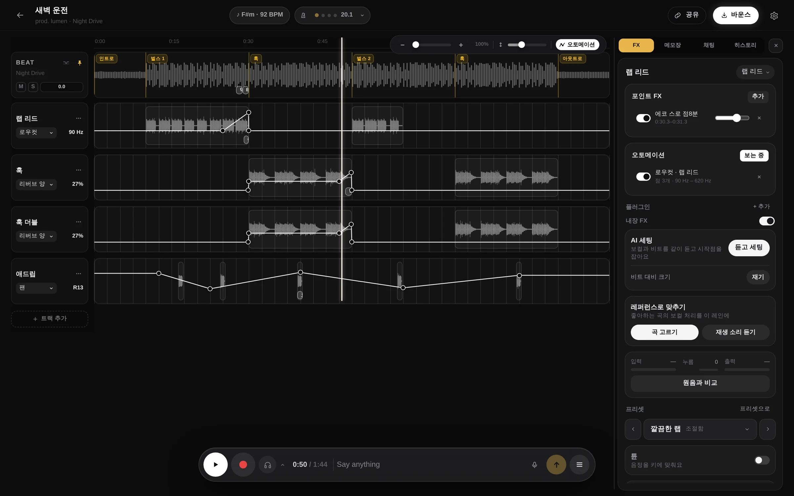
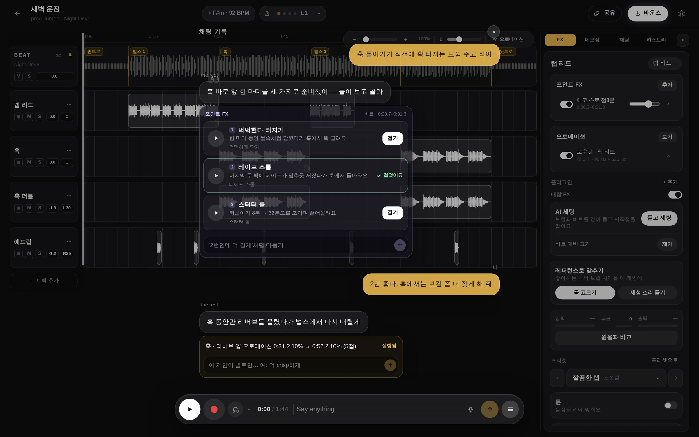
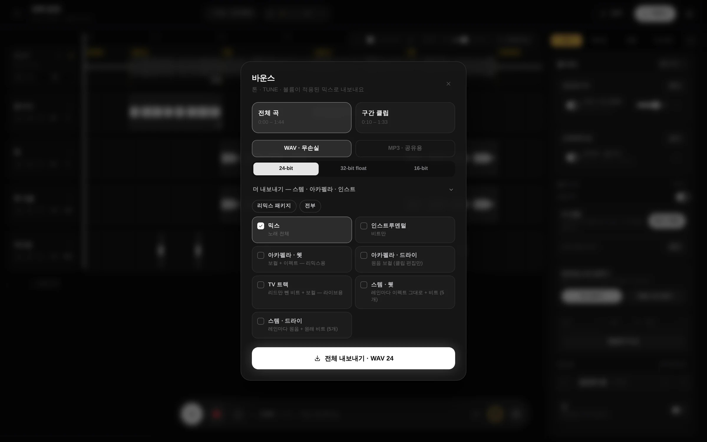
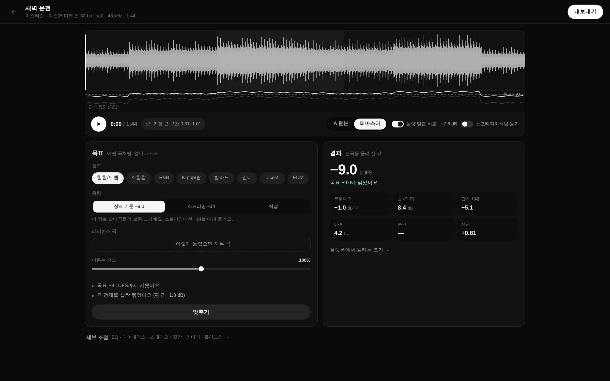
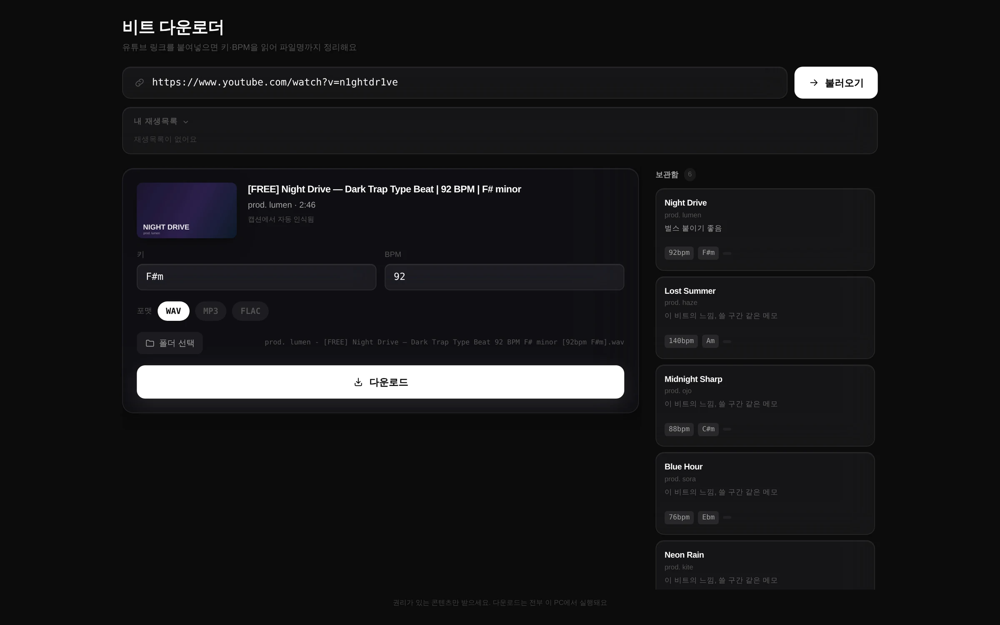

<p align="center">
  
</p>

<h1 align="center">the rest</h1>

<p align="center"><b>음악 만들기나 해. 나머지는 내가 해줄게.</b></p>

<p align="center">
  비트 위에 녹음하는 래퍼·보컬을 위한 부스.<br/>
  가사 쓰기, 녹음, 믹스, 마스터링, 리릭 비디오까지 데스크톱 앱 하나에서 해요.
</p>

<p align="center">
  <a href="https://github.com/1nsidewill/the-rest/releases/latest"></a>
  
</p>

<p align="center">
  <a href="https://github.com/1nsidewill/the-rest/releases/latest">다운로드</a> · <a href="README.md">English</a>
</p>



## 무엇을 하나요

비트로 프로젝트를 시작하고, 그 위에 레인을 나눠 테이크를 녹음해요. 메인, 훅, 더블, 애드립처럼요. 목소리 주변의 엔지니어링은 앱이 맡아요. 레인마다 걸리는 보컬 체인, 딱 한 지점에만 걸리는 이펙트, 곡을 따라 움직이는 값, 스템까지 나오는 바운스, 마스터링, 업로드할 리릭 비디오까지요.

전부 손으로 할 수도 있고, 말로 시킬 수도 있어요. "훅에서는 보컬 좀 더 젖게 해 줘"라고 하면 훅 레인에 리버브 오토메이션을 그려요. "훅 들어가기 직전에 확 터지는 느낌 주고 싶어"라고 하면 그 자리에서 들어 볼 수 있는 안을 세 개 내놓고, 고른 걸 걸어요.

[부스](#부스) · [보컬 체인](#보컬-체인) · [포인트 FX](#포인트-fx) · [오토메이션](#오토메이션) · [말로 시키기](#말로-시키기) · [바운스와 납품](#바운스와-납품) · [마스터링](#마스터링) · [리릭 비디오](#리릭-비디오) · [비트 다운로더](#비트-다운로더) · [같이 작업하기](#같이-작업하기) · [다운로드와 설치](#다운로드와-설치) · [이용과 가격](#이용과-가격) · [어디서 무엇이 도나요](#어디서-무엇이-도나요) · [소스 코드](#소스-코드)

## 부스

- 레인을 고르고 녹음하면 재생 헤드 자리부터 펀치인돼요. 테이크는 24-bit WAV로 저장되고, 오디오 인터페이스의 지연을 보정해서 박자에 맞게 놓여요.
- 구간 마커(인트로·벌스·훅), 키와 BPM, 메트로놈, 줌.
- 타임라인 옆에 가사 메모장이 있어요. 같은 라임은 같은 색으로 칠해지고, 줄마다 음절 수가 보이고, 녹음 직후 테이크를 받아써서 가사 줄로 넣을 수 있어요.
- 윈도우에서는 ASIO로 체인을 거친 내 목소리를 들으면서 녹음할 수 있어요.

## 보컬 체인



- 레인마다 체인이 걸려요. 프리셋 열 가지(깔끔한 랩, 센 랩, 멜로딕, 하드 튠, 훅 스택, 애드립, 전화기, 하이퍼팝 등)에서 시작해서 노브 다섯 개(톤·펀치·질감·공간·스택)로 다듬어요. 노브에 마우스를 올리면 실제 값이 보여요.
- **튠**은 음정을 곡의 키에 맞춰요. 자연스럽게부터 하드하게까지요. **피치 레이어**는 옥타브 아래 더블을 깔거나 목소리를 바꿔요.
- **AI 세팅**은 보컬과 비트를 같이 듣고 시작점을 잡아요. 프리셋, 노브, 튠, 입력 크기를 정하고, 둘이 부딪히는 대역에서만 비트를 깎아 자리를 내요. 내 컴퓨터에서 돌고, 무엇을 왜 바꿨는지 한 줄씩 알려 줘요.
- **레퍼런스로 맞추기**는 좋아하는 곡의 보컬을 내 컴퓨터에서 분리하고, 그 소리에 내 체인을 맞춰요. 컴퓨터에서 재생 중인 소리를 바로 들려줘도 돼요.
- 갖고 있는 VST3 플러그인을 내장 이펙트와 같이 체인에 넣을 수 있어요.

## 포인트 FX



딱 한 지점에만 걸리는 이펙트예요. 줄 끝 단어의 에코 스로, 훅으로 열리는 로우패스, 드롭 직전 테이프 스톱, 스터터 롤 같은 것들이요. 테이크나 비트를 우클릭해서 다섯 묶음(스로·스윕·질감·리듬·시간) 중에 골라요. 리듬을 타는 이펙트는 곡의 박자 격자에 맞고, 프리셋마다 걸기 전에 어떤 소리인지 알려 줘요. 리버스와 프리버브는 오디오로 구워서 새 레인에 놓아요.

## 오토메이션



**A**를 누르면 타임라인이 오토메이션 뷰로 바뀌어요. 레인마다 줄 하나가 보여요. 볼륨이나 팬, 또는 그 레인 체인의 값(리버브, 딜레이, 딜레이 되먹임, 로우컷, 프레즌스, 에어, 새추레이션, 와이드)이요. 눌러서 점을 놓고 끌어서 모양을 잡아요. 재생 중에는 점 하나가 줄을 따라가서 값이 움직이는 게 보여요. 재생, 바운스, 스템 모두 이 줄을 따라요.

## 말로 시키기



부스 아래 입력창에 쓰거나, 마이크 버튼을 누른 채 말하면 돼요. 손으로 하는 일 대부분을 할 수 있어요. 볼륨과 팬, 체인 바꾸기와 조절, 튠, 포인트 FX와 오토메이션, 테이크 옮기기, 그리고 테이크에서 음절을 찾아 박자 격자로 되풀이하는 스터터 편집까지요.

취향이 갈리는 요청에는 그 자리에서 들어 볼 수 있는 안을 카드로 내놓고, 마음에 드는 걸 걸면 돼요. 믹스가 어떠냐고 물으면 실제 오디오를 잰 값으로 답해요. 가사 첨삭도 카드로 제안하고, 받을지 말지는 내가 정해요.

## 바운스와 납품



곡 전체나 구간을 WAV(24-bit, 32-bit float, 디더링한 16-bit)나 공유용 MP3로 내보내요. 더 내보내기를 펼치면 엔지니어나 레이블이 달라는 것들이 있어요. 인스트루멘털, 아카펠라 웻·드라이, TV 트랙, 스템 웻·드라이요.

## 마스터링



장르와 음량 목표(장르 평균, 스트리밍 −14 LUFS, 직접 지정)를 고르고, 레퍼런스 곡이 있으면 넣은 다음 맞추기를 눌러요. 원본과는 음량을 맞춰서 비교하고, "스포티파이처럼 듣기"를 켜면 둘 다 서비스가 틀어 줄 크기로 들려요.

측정은 ITU-R BS.1770과 EBU R128 기준이에요. 통합 음량, 트루 피크, PLR, LRA, 스테레오 상관에 더해 플랫폼마다 몇 dB 줄이거나 키워서 트는지도 보여 줘요. EQ, 다이내믹, 스테레오, 질감, 리미터는 세부 조절에 접혀 있어요. WAV 24-bit, 디더링한 WAV 16-bit, MP3 320k로 내보내요.

## 리릭 비디오

https://github.com/user-attachments/assets/ab4e6e86-2beb-4767-b332-e23a5e704d62

오디오, 아트워크, 가사를 넣거나 바운스에서 바로 시작해요. 곡에 맞춰 Space를 두드려 줄마다 타이밍을 찍어요(←는 되돌리기, Tab은 건너뛰기). 배경과 EQ 색은 아트워크에서 뽑고, 가사에 `[이름]` 줄을 넣으면 싱어마다 색이 달라져요. 1920×1080이나 1080×1920, 60fps H.264로 렌더하고, 오디오는 다시 인코딩하지 않고 그대로 담아요. 크레딧을 넣은 유튜브 설명란도 만들어 줘요.

## 비트 다운로더



유튜브 링크를 붙여넣으면 제목과 설명에서 키와 BPM을 읽어요. "[FREE] Night Drive — Dark Trap Type Beat | 92 BPM | F# minor"는 `… [92bpm F#m].wav`로 저장돼요. WAV, MP3, FLAC 중에 고르면 돼요. 받은 비트는 키·BPM·메모와 함께 보관함에 쌓이고, 거기서 바로 프로젝트를 시작할 수 있어요. YouTube 권한으로 로그인하면 내 비트 재생목록도 여기서 바로 보여요. 다운로드에는 [yt-dlp](https://github.com/yt-dlp/yt-dlp)를 쓰고, 처음 쓸 때 한 번 받아요(약 35MB).

권리가 있는 것만 받아 주세요. 프로듀서마다 다른 라이선스 조건을 확인하는 건 사용자 몫이에요.

## 같이 작업하기

상대의 구글 이메일로 프로젝트를 공유하고 권한(편집, 듣기만)을 골라요. 상대가 녹음한 테이크는 곧 내 타임라인에도 올라오고, 프로젝트마다 채팅과 음성 채팅이 있어요. @핸들을 정하고 사람들을 팔로우하면 그 사람들이 공개한 바운스와 프로젝트가 피드에 떠요.

## 다운로드와 설치

[최신 릴리즈](https://github.com/1nsidewill/the-rest/releases/latest)에서 설치 파일을 받아요. 처음 한 번 설치하고 나면 그다음부터는 앱 안에서 업데이트돼요.

| 시스템 | 파일 |
|---|---|
| macOS 12 이상, Apple Silicon(M1 이후) | `The.Rest_<버전>_aarch64.dmg` |
| Windows 10·11, 64비트 | `The.Rest_<버전>_x64-setup.exe` (또는 `.msi`) |

**macOS.** `.dmg`를 열고 The Rest를 응용 프로그램 폴더로 끌어다 놓아요. 애플 개발자 인증서로 서명하지 않은 앱이라 처음 실행하면 "손상되었기 때문에 열 수 없습니다"라고 떠요. 실제로 손상된 게 아니라, 인터넷에서 받은 앱에 macOS가 붙이는 표시 때문이에요. 터미널에서 한 번만 지워 주세요.

```bash
/usr/bin/xattr -dr com.apple.quarantine "/Applications/The Rest.app"
```

`/usr/bin/xattr` 전체 경로로 입력해야 해요. pyenv나 Homebrew의 다른 `xattr`가 먼저 잡히면 `option -r not recognized` 오류가 나요.

**Windows.** 설치 파일을 실행해요. 코드 서명이 없어서 SmartScreen이 막으면 **추가 정보**를 누르고 **실행**을 눌러요.

**레퍼런스로 맞추기**는 보컬 분리 모델을 처음 한 번 받아요(약 90MB). macOS에선 14 이상이 필요하고, 재생 중인 소리 듣기는 14.2 이상에서 돼요. 윈도우에선 Microsoft Visual C++ 런타임이 필요해요.

## 이용과 가격

지금은 초대제 베타예요. 앱에서 구글로 로그인하면 대기 명단에 올라가고, 차례가 오면 열려요. 친구에게 받은 초대 코드가 있거나, 이미 쓰고 있는 사람이 내 이메일로 프로젝트를 공유하면 바로 들어올 수 있어요.

베타 동안은 무료예요. AI 기능은 계정마다 하루 한도가 있어요. 설정에서 내 OpenAI API 키를 넣으면 요청이 내 키로 OpenAI에 바로 가고, 한도가 적용되지 않아요.

## 어디서 무엇이 도나요

- **내 컴퓨터:** 오디오 엔진, 녹음, 이펙트와 믹스, 튠, AI 세팅, 레퍼런스로 맞추기의 보컬 분리, 마스터링, 리릭 비디오 렌더, 비트 다운로드.
- **개발자 서버:** 계정, 라이브러리(프로젝트·테이크·비트·바운스를 로그인한 컴퓨터 어디서나 보이게 동기화), 공유, 채팅과 음성 채팅.
- **AI 채팅과 테이크 받아쓰기**는 OpenAI가 처리해요. 개발자 서버를 거치고, 내 키를 쓰면 바로 가요.
- **새 프로젝트는 기본이 공개예요.** 누구나 내 프로필에서 들을 수 있고, 편집은 초대한 사람만 할 수 있어요. 프로젝트를 만들 때나 나중에 공유 창에서 비공개로 바꿀 수 있어요.

## 소스 코드

이 레포는 릴리즈를 배포하는 곳이에요. 여기 있는 소스는 0.4.3 버전 스냅샷(비트 다운로더와 리릭 비디오 스튜디오, MIT 라이선스)이에요. 그 뒤 버전은 비공개 레포에서 개발하고 있어서, 여기서 빌드하면 지금 앱이 아니라 0.4.3이 나와요.

<details>
<summary>0.4.3 소스로 빌드하기</summary>

```bash
# Node 20 이상, Rust(stable), npm 필요
git clone https://github.com/1nsidewill/the-rest.git
cd the-rest
npm install
npm run fetch-ffmpeg   # 번들 ffmpeg 준비
npm run desktop        # 개발 모드로 실행
```

</details>

## 피드백

버그 제보와 요청은 [Issues](https://github.com/1nsidewill/the-rest/issues)에 남겨 주세요.
