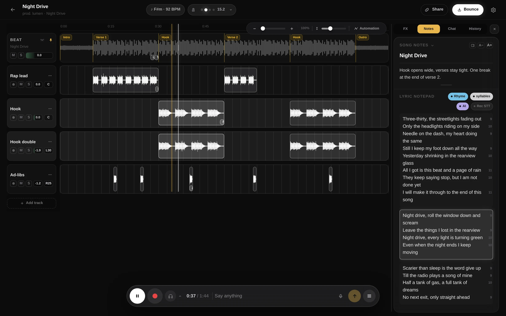
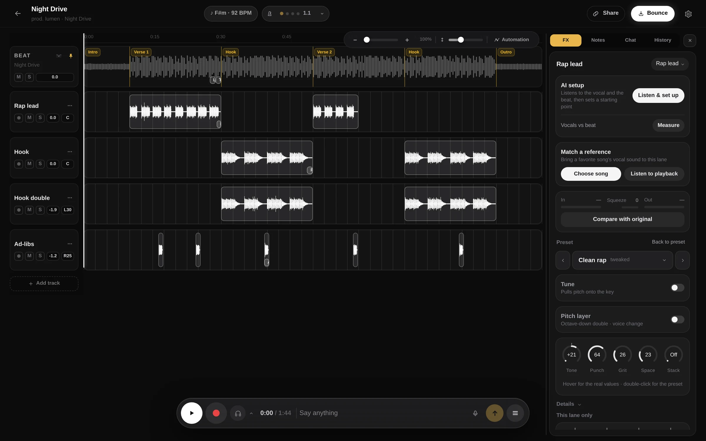
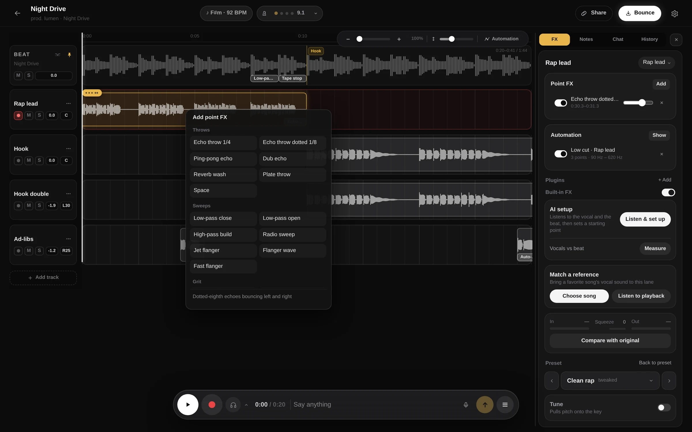
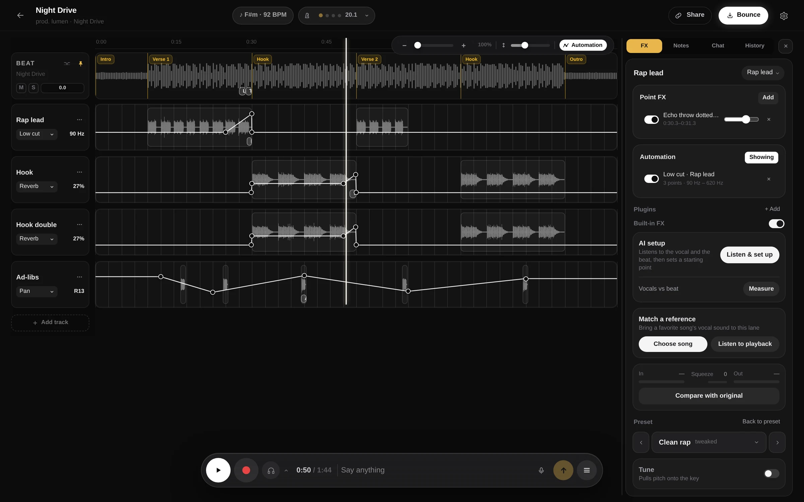
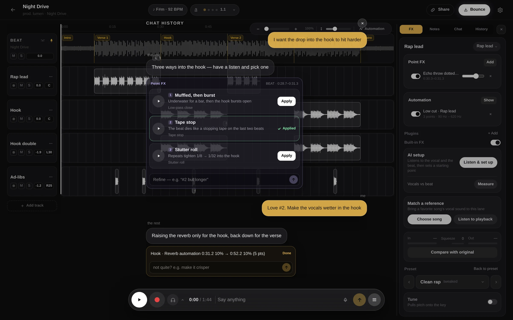
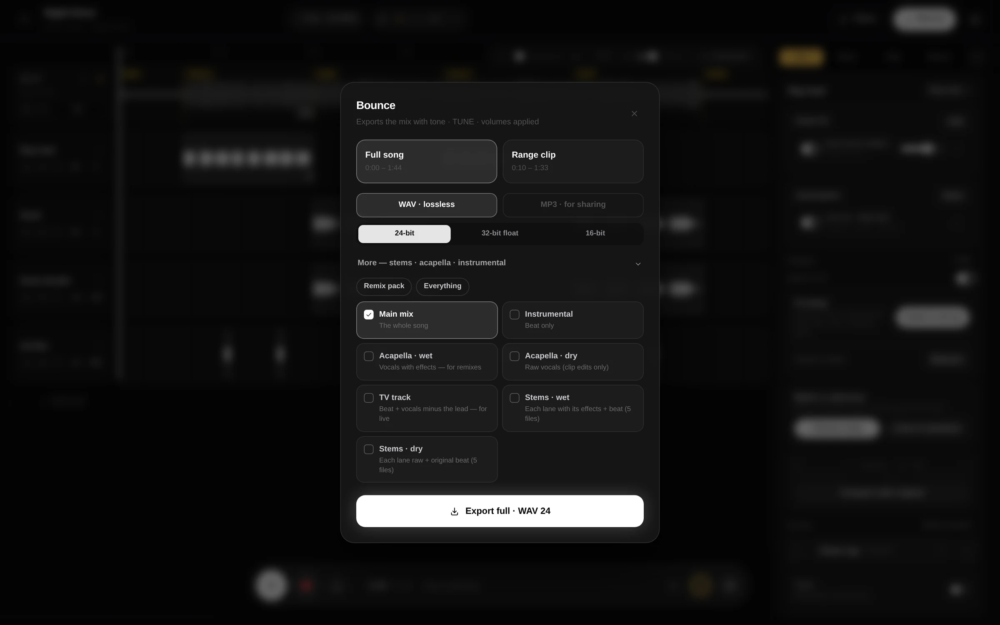
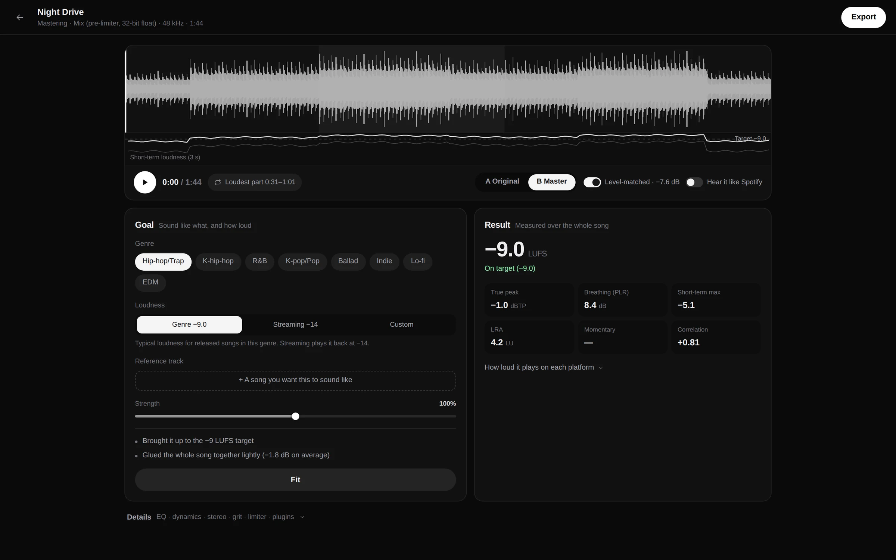
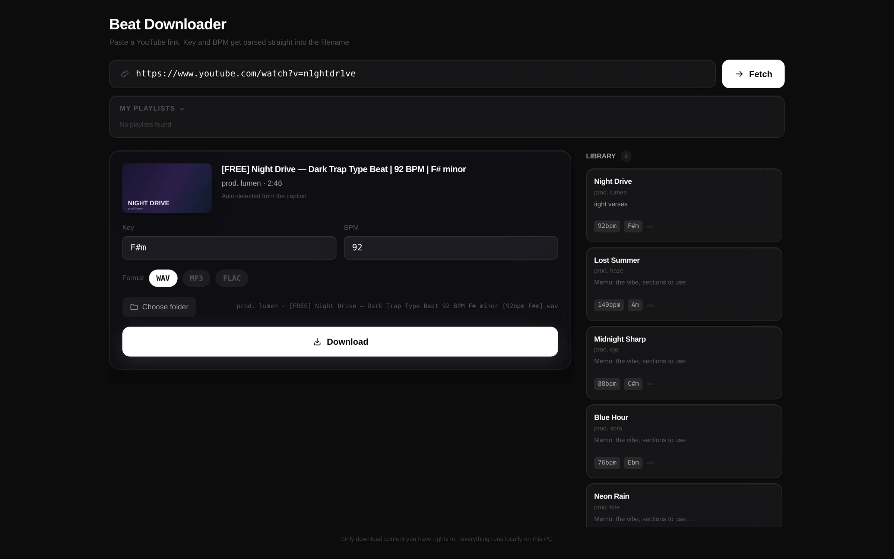

<p align="center">
  
</p>

<h1 align="center">the rest</h1>

<p align="center"><b>Just make music. I'll do the rest.</b></p>

<p align="center">
  A recording booth for rappers and singers who work over beats.<br/>
  Write, record, mix, master and make the lyric video in one desktop app.
</p>

<p align="center">
  <a href="https://github.com/1nsidewill/the-rest/releases/latest"></a>
  
</p>

<p align="center">
  <a href="https://github.com/1nsidewill/the-rest/releases/latest">Download</a> · <a href="README.ko.md">한국어</a>
</p>



## What it does

Start a project from a beat and record takes over it on separate lanes: lead, hook, doubles, ad-libs. The app handles the engineering around your voice: a vocal chain on every lane, effects that hit one exact spot, values that move through the song, a bounce with stems, a master, and a lyric video for the upload.

You can do all of it by hand, or ask for it in plain words. "Make the vocals wetter in the hook" draws reverb automation on the hook lanes. "I want the drop into the hook to hit harder" comes back as three options you can play in place before you pick one.

[The booth](#the-booth) · [Vocal chain](#vocal-chain) · [Point FX](#point-fx) · [Automation](#automation) · [Asking in plain words](#asking-in-plain-words) · [Bounce and delivery](#bounce-and-delivery) · [Mastering](#mastering) · [Lyric video](#lyric-video) · [Beat downloader](#beat-downloader) · [Working with others](#working-with-others) · [Download and install](#download-and-install) · [Access and pricing](#access-and-pricing) · [What runs where](#what-runs-where) · [Source code](#source-code)

## The booth

- Arm a lane and record. The take punches in from the playhead, is saved as 24-bit WAV, and lands in time: the app compensates for your audio interface's latency.
- Section markers (intro, verse, hook), key and BPM, a click, and zoom.
- The lyric notepad sits next to the timeline. Rhymes share a color, every line shows its syllable count, and takes can be transcribed into lyric lines right after you record them.
- On Windows, ASIO lets you hear yourself through the chain while you record.

## Vocal chain



- Every lane runs a chain. Start from one of ten presets (Clean rap, Loud rap, Melodic, Hard tune, Hook stack, Ad-lib, Phone, Hyperpop and more) and shape it with five knobs: Tone, Punch, Grit, Space and Stack. Hover a knob to see the real values behind it.
- **Tune** pulls pitch onto the song's key, from gentle to hard. **Pitch layer** adds an octave-down double or changes the voice.
- **AI setup** listens to the vocal and the beat together and sets a starting point: preset, knobs, tuning, input level, and room carved out of the beat only where the two collide. It runs on your computer and explains each change in a line.
- **Match a reference** takes a song you like, separates its vocal on your computer, and fits your chain to it. It can also listen to whatever is playing on your computer.
- Your VST3 plugins can sit in the chain next to the built-in effects.

## Point FX



Effects that happen at one spot and nowhere else: an echo throw on the last word of a line, a low-pass that opens into the hook, a tape stop before the drop, a stutter roll. Right-click a take or the beat and pick from five groups: throws, sweeps, grit, rhythm and time. Rhythmic effects lock to the song's beat grid, and every preset says what it does before you add it. Reverse and pre-verb are printed onto a new lane as audio.

## Automation



Press **A** to switch the timeline to automation. Each lane shows one line: its volume or pan, or a value from its chain (reverb, delay, delay feedback, low cut, presence, air, saturation, width). Click to place points and drag to shape them. A dot rides the line during playback so you can watch the value move. Playback, bounces and stems all follow it.

## Asking in plain words



The bar at the bottom of the booth takes requests, typed or spoken. It can do most of what you would do by hand: set levels and pans, switch or adjust chains, tune, add point FX and automation, move takes, and cut stutter edits by finding a syllable in your take and repeating it on the grid.

When a request comes down to taste, it answers with a card of options you can play in place, then apply the one you like. Ask how the mix sounds and it answers from measurements of the actual audio. It also suggests lyric edits as cards you can accept or ignore.

## Bounce and delivery



Export the full song or a range as WAV (24-bit, 32-bit float, or 16-bit with dither) or as MP3 for sharing. Open the delivery set for what engineers and labels ask for: instrumental, acapella wet and dry, TV track, and stems wet and dry.

## Mastering



Pick a genre and a loudness target (typical for the genre, streaming at −14 LUFS, or your own), add a reference track if you have one, and press Fit. Compare with the original at matched loudness, or turn on "Hear it like Spotify" to hear both the way the service will play them.

Measurements follow ITU-R BS.1770 and EBU R128: integrated loudness, true peak, PLR, LRA and stereo correlation, plus how much each platform will turn the song up or down. EQ, dynamics, stereo, saturation and the limiter are under Details when you want them. Export WAV 24-bit, WAV 16-bit with dither, or MP3 320k.

## Lyric video

https://github.com/user-attachments/assets/ab4e6e86-2beb-4767-b332-e23a5e704d62

Bring audio, artwork and lyrics, or start from a bounce. Tap Space along with the song to time each line (← undoes, Tab skips). The background and EQ colors come from the artwork, and `[Name]` lines give each singer their own color. Renders 1920×1080 or 1080×1920 at 60 fps in H.264 with the audio copied as-is (no re-encode), and writes a YouTube description with your credits.

## Beat downloader



Paste a YouTube link. The key and BPM are read from the title and description, so "[FREE] Night Drive — Dark Trap Type Beat | 92 BPM | F# minor" is saved as `… [92bpm F#m].wav`. Choose WAV, MP3 or FLAC. Each beat goes into your library with its key, BPM and a memo, ready to start a project from. Sign in with YouTube access and your own beat playlists show up here too. Downloads use [yt-dlp](https://github.com/yt-dlp/yt-dlp), fetched once (about 35 MB) on first use.

Only download what you have the rights to use. Checking each producer's license terms is up to you.

## Working with others

Share a project with someone's Google email and choose their role: edit, or listen only. Their takes arrive on your timeline shortly after they record them, and every project has its own chat and voice chat. Pick a handle, follow people, and see the bounces and projects they make public in your feed.

## Download and install

Get the installer from the [latest release](https://github.com/1nsidewill/the-rest/releases/latest). After the first install, updates arrive inside the app.

| System | File |
|---|---|
| macOS 12 or later, Apple Silicon (M1 or newer) | `The.Rest_<version>_aarch64.dmg` |
| Windows 10 or 11, 64-bit | `The.Rest_<version>_x64-setup.exe` (or the `.msi`) |

**macOS.** Open the `.dmg` and drag The Rest into Applications. The app isn't signed with an Apple developer certificate, so the first launch says it "is damaged and can't be opened." It isn't damaged; macOS flags apps downloaded from the internet. Clear the flag once in Terminal:

```bash
/usr/bin/xattr -dr com.apple.quarantine "/Applications/The Rest.app"
```

Type the full `/usr/bin/xattr` path. Another `xattr` earlier on your PATH (from pyenv or Homebrew) fails with `option -r not recognized`.

**Windows.** Run the installer. The app isn't code-signed, so SmartScreen may stop it: choose **More info**, then **Run anyway**.

**Match a reference** separates vocals with a model that downloads once (about 90 MB). On macOS it needs macOS 14 or later, and listening to what's playing needs 14.2. On Windows it needs the Microsoft Visual C++ Runtime.

## Access and pricing

The beta is invite-only. Sign in with Google in the app and you join the waitlist. You get in when your turn comes, with an invite code from a friend, or right away when someone already in the beta shares a project with your email.

The app is free during the beta. AI features have a daily limit per account. If you add your own OpenAI API key in Settings, requests go straight to OpenAI on your key and the limit doesn't apply.

## What runs where

- **On your computer:** the audio engine, recording, effects and mixing, tuning, AI setup, vocal separation for Match a reference, mastering, lyric video rendering and beat downloads.
- **On the developer's server:** your account, sharing, chat and voice chat, and your library (projects, takes, beats and bounces), which syncs so it's on every computer you sign in on.
- **AI chat and take transcription** are processed by OpenAI, sent through the developer's server, or directly if you use your own key.
- **New projects are public by default.** Anyone can listen to them from your profile, and only people you invite can edit. You can make a project private when you create it, or later from Share.

## Source code

This repository publishes the releases. The source code here is a snapshot of version 0.4.3 (the beat downloader and the lyric video studio, MIT license). Later versions are developed in a private repository, so building from this repository gives you 0.4.3, not the current app.

<details>
<summary>Build 0.4.3 from source</summary>

```bash
# Requires Node 20+, Rust (stable) and npm
git clone https://github.com/1nsidewill/the-rest.git
cd the-rest
npm install
npm run fetch-ffmpeg   # prepares the bundled ffmpeg
npm run desktop        # runs the app in development mode
```

</details>

## Feedback

Bug reports and requests go in [Issues](https://github.com/1nsidewill/the-rest/issues).
